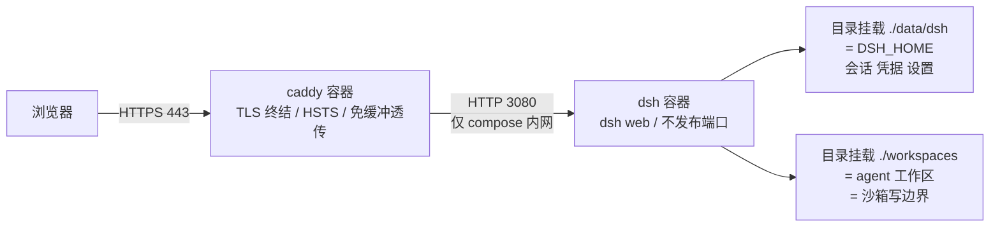
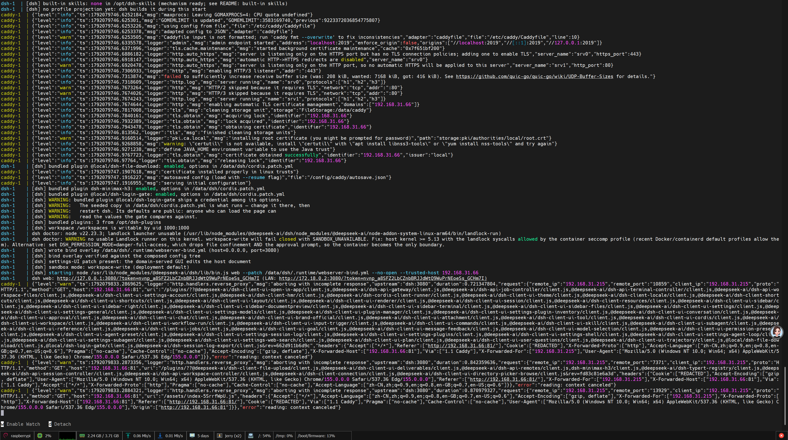
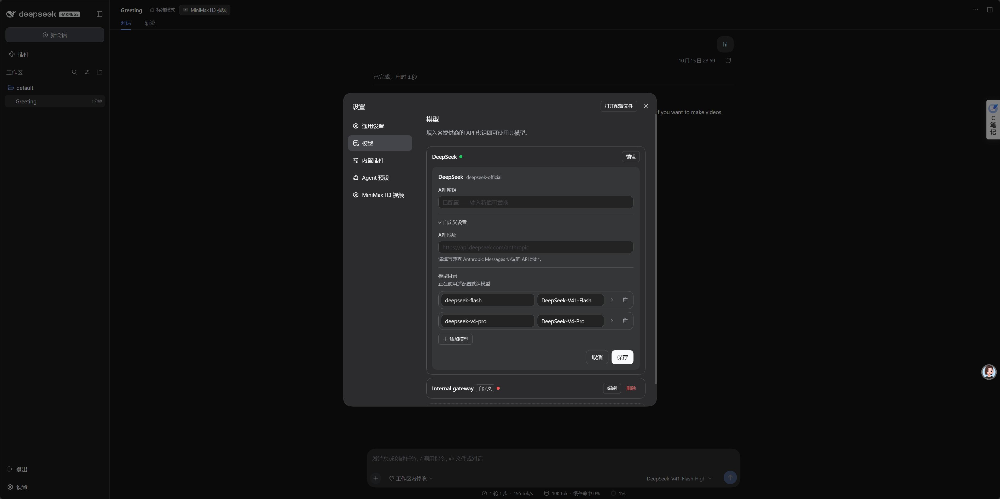
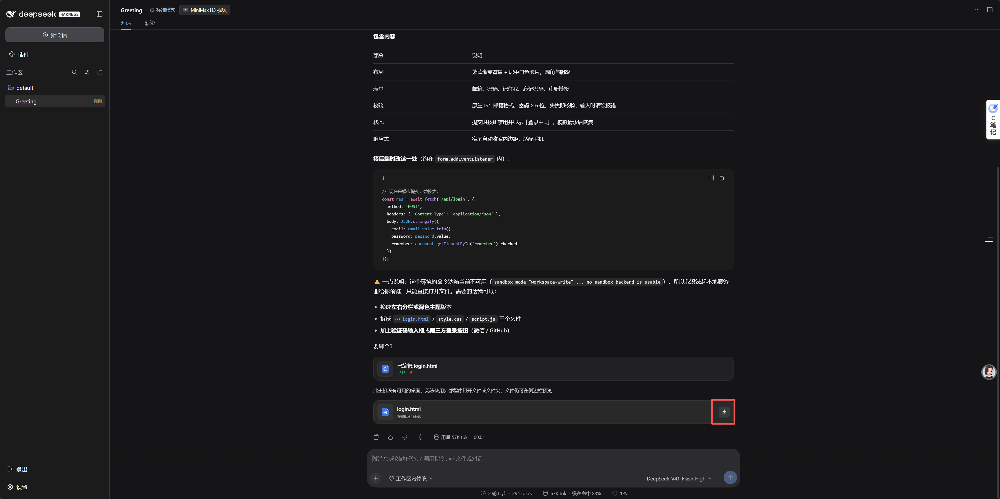
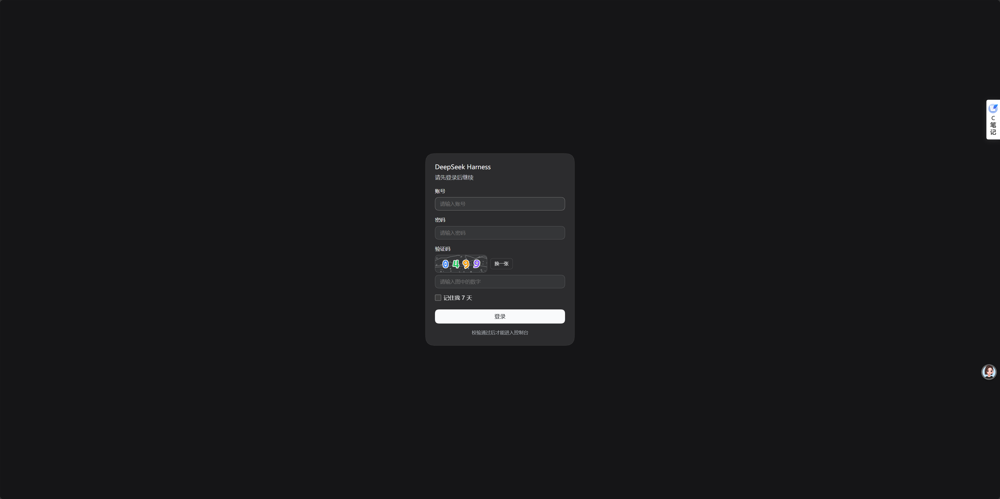

# 我写了一个真正能在 Docker 里跑起来的 DeepSeek Harness 部署模板

> 一个镜像、一个服务、一个对外入口（443）。
> **完整配置已开源：<https://github.com/zjwan461/dsh-docker>**
> 本文结论来自对 `@deepseek-ai/dsh` 源码与运行日志的核对。凡是我没验证过的，都会明确标出来。

---

## 0. 起因：一个"本地工具"，我偏要它在服务器上跑

DeepSeek Harness（下称 dsh）的定位很明确：**跑在自己电脑上的编码 agent**。

它自带 Web GUI，默认监听 `127.0.0.1`，启动时打印一条带 token 的地址，浏览器打开就能用。这在单机上完美，但意味着三件事：

- 我的会话、文件、API Key 全绑在**我这一台机器**上；
- 想让它在后台常驻、随手就能连上，就得有一台一直开着的机器；
- 机器重装、笔记本换代，一切重来。

所以我决定把它放到我自己的 Linux 服务器上，用域名访问。

听起来像"写个 Dockerfile 就完事"。实际做下来，它是一条**从"只服务 localhost"到"服务一个域名"的适配链**——几乎每一层都藏着 dsh 出于安全考虑而**故意**做的限制。

我前后推翻了自己好几版方案才让它真正跑起来。下面按"撞到什么 → 为什么撞上 → 最后怎么改"的顺序记录。

---

## 1. 最终形态



三个硬约束：

1. **宿主机只发布 443 一个端口**，dsh 服务自己不发布任何端口；
2. **Caddy 是这个栈唯一的网络入口**，同时承担域名虚拟主机、TLS 终结、反向代理；
3. **只有一个服务**（外加一个纯静态的代理容器），没有第二个业务容器。

> **为什么我只发一个端口而不是随便发几个。** Caddy 的内部 CA 对**所有**主机名只有**一个根证书**，所以浏览器只需要做**一次**信任决定。多一个入口，就多一次"这张证书要不要信"的交互，也就多一条可能被绕过的路径。

### 为什么不加 nginx（架构决定，勿重复讨论）

Caddy 已经同时干了**域名虚拟主机、TLS 终结、反向代理**三件事。再挂一层 nginx 就变成 `nginx(TLS) → caddy(TLS) → dsh`：两个 TLS 终结者、证书管两处，而浏览器信任的始终只是最外层那一张，纯属多一跳。

- **想用自己签的证书**：不需要 nginx，走下面的 Option B，把证书文件喂给 Caddy 即可。**证书由谁签发 ≠ 必须由谁托管。**
- **只有一种情况值得引入 nginx**：TLS 必须在你**已有的集中入口**（nginx / F5 / LB）终结。那时的正确做法是**把 compose 里的 caddy 服务整个删掉**，让 nginx 直接反代 dsh，而不是两层叠加。届时必须做到五件事：`proxy_set_header Host $host`（nginx 默认是 `$proxy_host`，会直接踩到 /api 信任围栏 403）、`proxy_buffering off`（SSE）、WebSocket upgrade 头、`client_max_body_size` 提到 300m 以上（否则上传 413）、以及明文那一跳只允许走 loopback 或 compose 内网。

### 镜像里为什么是 `python:3.11-slim-bookworm`

这一条我一开始觉得离谱——一个 Node 应用为什么用 Python 镜像？答案是：**它只是碰巧提供了一个已验证过的 glibc 基线。**

| 事实（已核对源码 / 构建配置） | 由此产生的决策 |
|---|---|
| CLI 依赖 `commander@15`，`engines` 为 `>=22.12.0` | Node 必须 ≥ 22.12，故用 NodeSource 装 Node 22 |
| `node-pty` 自带 `prebuilds/linux-x64`，`sharp` / `@vscode/ripgrep` / `landlock-run` 都是预编译包 | 镜像里**不需要** gcc / python-dev |
| musl 下 `node-pty` 会退化成源码编译 | **不要换 Alpine** |
| Linux 沙箱链是 `bwrap → Landlock`，按序探测，两者都不可用则 fail closed（`SANDBOX_UNAVAILABLE`） | 镜像**故意不装 bubblewrap**，让容器稳定落到无需任何特权的 Landlock |

Python 解释器在这个栈里**不是"用来跑应用"的**——应用是 Node。它随基础镜像白拿，而我在下面的「镜像里预装了什么」一节里把它变成了 agent 的实际能力。保留这个基线还有一个理由：它是**目标主机上验证过的配置**——换成 `node:22-bookworm-slim` 会同时动两件事：npm 全局前缀的位置，以及 `useradd --create-home` 会**静默变成 no-op**（官方 node 镜像已经有 uid 1000 的 `node` 用户），那会导致 `DSH_UID != 1000` 时运行时身份没有可写的 `$HOME`。

---

## 2. 适配链第一层：网络入口

dsh 的 HTTP 服务**没有 TLS**，也**没有自己的账号体系**。唯一的认证是启动时随机打印一次的 token，换取一个签名 cookie。

所以 Caddy 这一层是必需品，不是可选项。

### 2.1 `dsh web --host 0.0.0.0` 被 CLI 明确拒绝

反代要访问容器，容器必须绑所有网卡。但 CLI 出于安全考虑拒绝 `--host 0.0.0.0`（usage error 退出）。

解法是用 `--patch` 覆盖层：

```yaml
# 由 entrypoint 每次启动生成，容器内 $DSH_HOME/.runtime/webserver-bind.yml
- id: webserver
  config:
    host: 0.0.0.0
    port: !!js ctx.webStartup.port ?? 3080
    compression: gzip
    compressionLevel: 1
    compressionThresholdBytes: 1024
```

两个容易忽略的细节：

- **一个 patch 会替换目标行的整个 `config`**，所以该行拥有的每个 key 都必须在这里重新声明——这就是 `compression*` 三个字段出现在这里的原因；
- `port` 保留了 bundle 层原有的 `!!js ctx.webStartup.port ?? 3080` 表达式，这样 `command: ["--port", "9000"]` 仍然能覆盖这个默认值。

**为什么不直接改 profile 自己的 `cordis.patch.yml`？** 因为 profile 首次初始化时写入的是内容为 `[]` 的 YAML 文档，往后面追加条目会直接得到非法 YAML。而 `--patch` 覆盖层**最后应用、幂等、且能扛过镜像升级**。

### 2.2 启动日志里那句自检

```bash
docker compose logs dsh | grep 'bind overlay verified'
# [dsh] bind overlay verified against the composed config tree
```

这个自检值得单独说：**patch 如果目标不匹配，dsh 只会报告而不会中止启动**。也就是说，覆盖层写错了会得到一个"正常启动但反代永远 502"的容器。所以我宁愿在这里大声喊出来。

entrypoint 里的实现：

```bash
if dump="$("${DSH_CMD[@]}" "$SUBCMD" --patch "$OVERLAY" --dump-config 2>&1)"; then
  if grep -q "host: ${BIND_HOST}" <<<"$dump"; then
    log "bind overlay verified against the composed config tree"
  else
    warn "the composed config tree does not report 'host: ${BIND_HOST}'. The reverse proxy will not reach this container."
  fi
fi
```

注意它的失败语义是 **warning，永远不致命**——作者的注释原话是"宁愿在这里喊，也不让代理永远返回 502"。

### 2.3 SSE 不缓冲，一行都不能少

```caddyfile
reverse_proxy {$DSH_UPSTREAM} {
    flush_interval -1
}
```

少了这一行，GUI 会"连上了但永远加载不完"——事件流被攒到最后一次性吐出来。

另外，**`reverse_proxy` 默认保留进来的 Host 头，这里不要加 `header_up Host` 覆盖**，原因见下一节。

---

## 3. 适配链第二层：身份与信任围栏（踩坑最密集的一层）

### 3.1 坑一：`DSH_TRUSTED_HOSTS` 写成 `dsh.example.com:443` 会永远 403

这是我最开始想当然写错的地方。核对 `dsh-client-connection` 的 `isTrustedAuthority` 实现：

```js
// 无端口条目 -> 只比 hostname；带端口条目 -> 比 host:port
return canonical === entryUrl.hostname
  ? entryUrl.hostname === hostUrl.hostname
  : entryUrl.host === hostUrl.host;
```

而 WHATWG 归一化会把 `https://` 的默认端口 443 变成"没有端口"，浏览器访问默认端口的 HTTPS 时 Host 头本来就不带端口。

**结论：`dsh.example.com:443` 永远匹配不上；裸域名才匹配，而且对任意端口都成立。** entrypoint 检测到这种写法会直接在启动日志里告警：

```
[dsh] WARNING: trusted host 'dsh.example.com:443' carries an explicit default port.
Browsers omit the default port from the Host header, so this entry will never match
a browser request. Use the port-less form instead, which already matches every port: dsh.example.com
```

Origin 比对（`new URL(origin).host === hostUrl.host`）两边同样归一化，所以默认 443 不会造成 403。

> 顺带一个必须知道的边界：`DSH_TRUSTED_HOSTS` 必须是**裸 authority**。写成 `https://dsh.example.com` 或带路径会让插件加载直接报错。

### 3.2 坑二：cookie 故意不带 `Secure`，所以明文通道是禁区

dsh 的会话 cookie 是 `HttpOnly; SameSite=Strict; Path=/`，但**没有 `Secure`**——项目假设它跑在 loopback HTTP 上。

反过来推：**绝不要为同一域名再开一个明文 HTTP 入口**，第一次明文请求就会把 cookie 泄露给链路上的观察者。这也正是 Caddyfile 里显式关掉 `:80` 跳转监听、并上 HSTS 的原因：

```caddyfile
{
    auto_https disable_redirects
}
```

### 3.3 坑三：token 与 cookie 是两套东西，有效期完全不同

这一层我第一次读文档时理解错了。实测 + 源码核对之后是这样：

| 操作 | token | 已登录的浏览器 |
|---|---|---|
| `restart` / `up -d --build` | 换新 | ✅ 仍有效（签名密钥持久且未过期） |
| 改 `DSH_PUBLIC_PORT` 或域名 | 换新 | ❌ 需用新 token 重新登录 |
| 删掉 `data/dsh/.credentials.yaml` 后重启 | 换新 | ❌ 等于吊销所有会话 |
| 只清浏览器 cookie | 不变 | ❌ 用当前进程日志里的 token 重新登录 |
| 超过 30 天 | 不变（进程未重启时） | ❌ cookie 过期 |

机制上：

- **token**：`randomBytes(32)` → base64url **43 字符**，每个进程启动时重新生成，**只存在于内存、不落盘**，进程内固定（HMR / 插件重载不会换）；
- **cookie**：HMAC-SHA256 签名（`v1.<payload>.<sig>`），签名密钥 32 字节随机、**持久化在 `$DSH_HOME/.credentials.yaml`**，只在缺失时生成，默认有效期 **30 天**（`cookieMaxAgeDays`，最小 1）；
- cookie 的 payload 绑定了 `authority`（归一化后的 `host:port`），**换端口或换域名会让旧 cookie 失效**。

两条运维含义，都很反直觉：

1. **重启不是吊销手段**。它换了 token，但已登录的浏览器照旧能用。要吊销所有人只能删密钥：
   ```bash
   docker compose exec dsh rm /data/dsh/.credentials.yaml && docker compose restart dsh
   ```
2. **token 自身没有过期时间**，只要进程没重启，日志里那个链接就一直可用。它**等同于密码**，而且明文出现在 `docker logs` 里——不要贴进工单或聊天工具。

合法 token 只在不带其他参数的 `GET /` 上被接受（源码里是 `pathname === "/" && tokens.length === 1 && tokenMatches(...)`），带别的参数直接 401。

---

## 4. 适配链第三层：沙箱

这是整个项目里最"值钱"的一层，因为它决定了**你敢不敢把 agent 放上服务器**。

dsh 在 Linux 上的沙箱链是 `bwrap → Landlock`，按顺序探测。容器里 bwrap 需要非特权 user namespace + 放宽的 seccomp，很容易失败；而 Landlock 只需要内核支持。

所以镜像的策略是：**故意不装 bubblewrap**，让容器确定性地落到 Landlock 这一级。

- 宿主内核要求 **≥ 5.13**（Landlock ABI v1），且容器 seccomp 放行 landlock 系统调用（较新的 Docker/containerd 默认 profile 已放行）；
- dsh 是 **fail closed** 的：两个 runner 都不可用时报 `SANDBOX_UNAVAILABLE` 而不是无沙箱裸跑。所以"缺 runner"这件事是响亮的，不是静默的。

启动时体检会打印实际落到哪一级：

```
dsh doctor: node v22.23.2; landlock launcher full
(/usr/local/lib/node_modules/@deepseek-ai/dsh/node_modules/@deepseek-ai/node-addon-system-linux-x64/bin/landlock-run)
```

验收方式很直接——在 GUI 里让 agent 试着写一个工作区外的路径：

```
[dsh: file access denied under workspace-write mode]
```

### 4.1 但我在 ARM64 上没拿到它（这段是实话）

上面那两行是我在 x86_64 上看到的**完整形态**。而我把同一套东西往一台 **ARM64 小机器**上部署时，落下来的是这个：

```
dsh doctor: node v22.23.3; landlock launcher unusable (/usr/lib/node_modules/@deepseek-ai/dsh/node_modules/@deepseek-ai/node-addon-system-linux-arm64/bin/landlock-run)
dsh doctor: WARNING no usable Landlock runner on this kernel. workspace-write will fail closed with
SANDBOX_UNAVAILABLE. Fix: host kernel >= 5.13 with the landlock syscalls allowed by the container seccomp
profile (recent Docker/containerd default profiles allow them). Alternative: set
DSH_PERMISSION_MODE=danger-full-access, which drops file confinement AND the approval prompt, so the
container becomes the only boundary.
```

**注意它报的是 `unusable`，不是 `partial`。** 这两个词在 `doctor.mjs` 里是严格分开的：

| 结论 | 含义 | 文件约束 |
|---|---|---|
| `full` | 内核 Landlock 可用且 ABI 够新 | 完整生效 |
| `partial` | 内核 Landlock ABI 较旧 | **仍然限制文件写入**，只是部分新权限位不受治理（可接受） |
| `unusable` | **完全没有可用的 Landlock** | `workspace-write` 会 fail closed，即 `SANDBOX_UNAVAILABLE` |

所以 `unusable` 不是"效果打折"，而是"这一层根本不在"。这时候只有两条路：让内核/seccomp 放行 landlock，或者退到 `danger-full-access`——**而后者的代价是双重**：

> `which drops file confinement AND the approval prompt, so the container becomes the only boundary.`

**文件约束没了，审批提示也一起关了。** 这就是为什么我在第 12 节单独强调 `danger-full-access` 是一条比字面看起来更宽的开关。真要走这条路，就必须把挂载面收到最小（只挂 `./data/dsh` 和专用工作区，绝不放 `docker.sock`、家目录、SSH 私钥）。

### 4.2 这一段的副产品：一个很容易踩的架构坑

那次 `unusable` 里有个细节值得单独拎出来——**launcher 的路径是 `node-addon-system-linux-arm64`**。

如果你看过第 7 节讲的"预发布版本漂移"，会记得 `landlock-run` 来自 `@deepseek-ai/node-addon-system` 这个包。而它是**按平台分发的可选依赖**：

```
@deepseek-ai/node-addon-system-linux-x64
@deepseek-ai/node-addon-system-linux-arm64
```

npm 装哪个，取决于**安装时所在的平台**。所以：

- **在 x86_64 上构建镜像、拿到 ARM64 上跑**（或反过来）⇒ 平台包不对 ⇒ launcher 二进制要么缺失、要么不能执行；
- 这也正是 `doctor.mjs` 里那条"launcher binary is missing"提示存在的原因，它的建议是**在目标主机上重建**：

```bash
docker compose build --no-cache dsh
```

**结论：镜像必须在与运行架构一致的机器上构建。** 跨架构部署（比如你在 x86 笔记本上构建、推给 ARM64 服务器）时，别指望它自带正确的平台包——要么用目标平台构建，要么用 `buildx` 构建对应平台并确认可选依赖装上了。

> ⚠️ **一个我不能替你确认的前提**：NodeSource 的 Node 22 在 ARM64 上的可用性，以及 `node-addon-system-linux-arm64` 这个可选依赖是否真的在树莓派上装成功了——**这两件事都要在你自己那台机器上验证**：`docker compose exec dsh node -v` + 上面那条 `grep 'landlock launcher'`。我这台 ARM64 机器的结论是 `unusable`，但**原因是内核/seccomp 还是平台包，从日志里区分不出来**，得你自己进一步查。

### 4.3 但这次"失败"其实验证了设计

我倒不觉得这次踩坑是白费。它恰好证明了三件事：

1. **dsh 是 fail closed 的。** 它没有"悄悄降级成无沙箱继续跑"，而是把结论**打进启动日志**并拒绝在 `workspace-write` 下开工——**"缺 runner"这件事是响亮的，不是静默的**。这正是我第 1 节说的那个设计意图。
2. **`doctor.mjs` 的措辞是可核查的。** 它把三种结论、修法（内核 ≥ 5.13 + seccomp 放行）、以及那条替代方案的**完整代价**都写在同一段警告里。你不需要去翻文档就知道下一步该做什么。
3. **它给了你一个明确的决策点**，而不是让你在"能跑但不知道安不安全"的状态里继续用。

### 4.4 完整的启动日志（这张图值得对着看一遍）

下面这是一次真实 `docker compose logs -f dsh` 的截取。它一次把前面所有机制都串起来了，我标一下该看哪几行：



从上往下，**每一段都对应本文的一节**：

| 日志行 | 对应 |
|---|---|
| `[dsh] dsh CLI: npm CLI at ...` | 第 2 节：entrypoint 用的是绝对路径解析出来的 npm CLI，不是 PATH 上的裸 `dsh` |
| `[dsh] no profile projection yet: dsh builds it during this start` | **正常状态**——全新 home 的首次启动，投影正在这一次建立（第 7 节） |
| `[dsh] bundled plugin @local/dsh-file-download: enabled, options in /data/dsh/cordis.patch.yml`<br>`[dsh] bundled plugin dsh-minimax-h3: enabled, ...`<br>`[dsh] bundled plugin @local/dsh-login-gate: enabled, ...` | 第 9 节：**三个插件**逐个软链 + patch 播种 |
| `[dsh] WARNING: bundled plugin @local/dsh-login-gate ships a credential among its options.` | 第 9.4 节：凭据嗅探告警——它在提醒你默认密码是公开的 |
| `[dsh] workspace /workspaces is writable by uid 1000:1000` | 第 5 节：预检通过 |
| `dsh doctor: ... landlock launcher unusable (...)` + `SANDBOX_UNAVAILABLE` 警告 | **第 4.1 节**：这就是我那次 ARM64 的实况，fail closed |
| `[dsh] wrote bind overlay ... (host=0.0.0.0, port=3080)`<br>`[dsh] bind overlay verified against the composed config tree` | 第 2.1 / 2.2 节：覆盖层生成 + **自检通过**。少了第二行就是 patch 没命中，要去看 502 |
| `[dsh] settings-UI patch present: the domain-served GUI edits the host document` | 第 6 节：构建期补丁的启动期复核通过 |
| `[dsh] sandbox mode: ...`<br>`[dsh] starting: node ... web --patch ... --no-open --trusted-host ...` | 第 2 节：最终 exec 的命令行——`--patch` 和 `--trusted-host` 都在 |
| 最后 `dsh web: ...?token=...` | **首次登录令牌**。这是全篇唯一需要你小心处理的一行（见下） |

> ⚠️ **这张图如果要用，必须涂掉四处**（我原图里都有）：
>
> 1. **`token=` 后面那一整串**——它等同于界面密码。发布前涂掉，或者先 `docker compose restart dsh` 让旧令牌作废（令牌每次启动都换，所以重启即失效）；
> 2. **主机名与用户名**（截图里终端提示符上的 `user@host`）；
> 3. **`--trusted-host` 后面的内网 IP**，以及那些 `client_ip` / `X-Forwarded-For` 行；
> 4. `uid 1000:1000` 这类宿主身份信息，看你要不要留。
>
> **沙箱那几行我建议保留**——它们恰恰是第 4.1 节的证据，删了反而让那段话没有配图。

### 4.5 但必须说清楚 `workspace-write` 的边界（就算它生效了）

**它只限制写文件。读和网络不受限。** agent 仍然可以访问容器能访问到的一切网络——包括 `api.deepseek.com` 和你其它本地服务。需要更强隔离请把它放到独立网段。

另外 `danger-full-access` 会**同时**把审批策略变成 `never`，这是一条比字面看起来更宽的开关。

---

## 5. 适配链第四层：持久化（一个 `EBUSY` 教我的事）

`$DSH_HOME`（容器内 `/data/dsh`）里装着：profiles、sessions、storages、`settings.yaml`、`.credentials.yaml`。

我最初想用**单文件挂载** `./data/dsh/settings.yaml:/data/dsh/settings.yaml`，因为"我只想共享这一个设置文件"。结果发现不行，原因是 dsh 的配置编辑是**原子写**：

```
dsh-config-editor -> writeFileAtomic, under withFileLock
```

也就是"写临时文件 + `rename()` 覆盖目标"。而：

- **单文件挂载**时，`rename()` 的目标是**挂载点本身** ⇒ `EBUSY`；
- 加 `:ro` 则 ⇒ `EROFS`。

**只有目录挂载能让 `rename()` 退化成一次普通的目录内操作**，于是宿主编辑与 UI 保存写的是同一个真文件，两个方向都成立、两份副本不可能分叉。

```yaml
volumes:
  - ./data/dsh:/data/dsh
  - ${DSH_WORKSPACES:-./workspaces}:/workspaces
```

配套的三个坑：

- **宿主目录必须事先存在**。Docker 会把缺失的 bind 源创建成一个 **root 所有的目录**——如果它恰好是 `settings.yaml`，你会得到一个"设置文件是个目录"的诡异状态。entrypoint 专门检查这个并给出修法（`rmdir` 后 `git checkout` 再 `--force-recreate`）。
- **属主必须对得上**：宿主目录属主和 `DSH_UID/DSH_GID` 不一致时，entrypoint 会打印实际属主和两种修法后直接退出（`$DSH_HOME is not writable`）。
- **热重载依赖 inotify 到达容器**。Linux 服务器上没问题；Windows/macOS 的 Docker Desktop 可能不传播文件事件——退回 `docker compose restart dsh`。

而这份 `settings.yaml` 本身就是一份**上服务器前的改动清单**，这个设计我很喜欢——它把"部署时要改什么"写在了要改的那个文件里：

```yaml
# ── 放上服务器后按这个清单改 ────────────────────────────────────────────────
#   [ ] 1. vllm-local.baseURL        → 你的 LiteLLM 地址（含 /v1）
#   [ ] 2. vllm-local.models[].id    → LiteLLM /v1/models 返回的 id
#   [ ] 3. models[].contextWindow / maxTokens → vLLM 的真实上限
#   [ ] 4. 取消注释 agent-default-model，provider/model 与上面一致
#   [ ] 5. 把该端点地址加进 ~/.docker/config.json 的 noProxy
#   [ ] 6. LITELLM_API_KEY 写进 .env
#   [ ] 7. 升级 dsh 后核对字段名没变（字段名写错是静默失效，不报错）
```

第 7 条尤其值得学：**"字段名写错是静默失效"**——所以它给了一条 `grep` 命令让你去源码里确认字段还在。它还标了一处实测结论：`0.1.5-rc.3` 下 `DEFAULT_INPUT` 仍是 `["text"]`，**所以模型配置里不写 `input: [text, image]` 就没有图片能力**。

---

## 6. 适配链第五层：让"域名访问时设置页也能用"（全文最技术的一段）

这一层是我最想分享的，因为它展示了一种**不 fork、不编译、不 rebase 的改上游行为的方法**。

### 6.1 症状

从域名打开 GUI，进"设置 → 模型"，页面报：

```
Loading the provider directory failed: settings are available in this browser
```

### 6.2 根因：一个在浏览器里做的硬编码判断

dsh 决定"设置文档存在哪里"是在**浏览器里**做的，而且是硬编码的：

```js
// dsh-client-ui-settings/lib/client.js
const persistence = ctx.remote.$host.isLoopback ? "host" : "memory";
```

而 `$host.isLoopback` 来自连接层自己的定义：

```js
// dsh-client-connection/lib/client.js
isLoopback: transport?.ownsHost === true || pageLocation === void 0
          || isLoopbackHostname(pageLocation.hostname)
```

从域名访问时**三项全不成立** ⇒ `persistence = "memory"` ⇒ Models 页读的是一份**会话内的**文档。

而且注意：**General 设置页另有一处独立但同源的门禁**（`dsh-client-ui-settings-general`）。两处门禁读的是同一个标志。

### 6.3 解法：改那个"定义"，而不是改那两个"消费者"

`patch-client-settings.mjs` 做的事情极小——把上面那条定义改成 `true`，**在构建期以 root 应用**。

三条理由，每条都是被现实逼出来的：

**① 不需要编译源码。** 浏览器拿到的不是预构建产物：`dsh-client-modules` 是从磁盘读每个插件的 `lib/client.js`，再以 `plugins/<id>/client.js` 提供。**改这个文件就是改浏览器实际执行的东西**——不用编译 monorepo、不用 fork、不用每次发版 rebase。

**② 只改定义那一处，两处门禁同时生效。** 这是刻意的：`-general` 那处的周边代码在 `0.1.5-rc.1 → 0.2.0-rc.2` 之间**已经变过**（`ctx.settingsScope.describe()` → `ctx.configForms.describe()`），而定义那一行**逐字未变**。

**③ 不依赖行号，而且要幂等。** 锚点是整条表达式：

```js
const ANCHOR = /(isLoopback:\s*)transport\?\.ownsHost === true \|\| pageLocation === void 0 \|\| isLoopbackHostname\(pageLocation\.hostname\)(,)/g;
```

理由写在脚本注释里，我认为值得抄：

> Anchored on the whole ternary rather than on a line number, because line numbers move between releases (0.1.5-rc.1 → 0.2.0-rc.2 moved every gate) and a stale line number would silently patch the wrong thing.

配套的防御（每一条我都会在自己的脚本里复刻）：

- 匹配到 0 次或**多于 1 次**都判失败（"expected exactly 1"），避免误改；
- **幂等判据是标记子串**（`PATCHED by dsh-docker`），不是重新匹配锚点——所以重复运行是安全的；
- 写盘前做**语法校验**，而且用的是 `vm.Script` 而不是 `node --check`。原因很细：`dsh-client-modules` 把这些 bundle 当**经典脚本**加载，`vm.Script` 才是诚实的解析器；而 `node --check` 有两个坑——它**拒绝对不认识的扩展名做检查**（早期版本把暂存文件命名为 `.tmp`，这道门就每次都失败），并且它会从最近的 `package.json` **推断模块系统**，而那个和浏览器怎么处理这个文件无关；
- **暂存在目标同目录再 `rename`**，理由两条：pnpm 用**硬链接**从内容寻址存储里取包文件，原地写会污染那份共享副本；而 `/tmp` 可能不可写或跨文件系统，会把一次简单替换变成 `EACCES` 或 `EXDEV`；
- 定位不靠猜路径：先用 Node 的解析器找 `@deepseek-ai/dsh-client-connection`，再退回**跟随符号链接**的遍历。第二条是必需的——pnpm 的 `node_modules` 全是符号链接，而 `Dirent` 的 `isDirectory()/isFile()` 对符号链接**都是 false**，不跟随就什么都找不到；
- 匹配不到时不是抛个错就完，而是打印"该用哪条 `grep` 去找上游的新写法"：
  ```
  grep -n 'isLoopback' <paths...>
  then update ANCHOR in this script. Do not fall back to a line number.
  ```

**补丁失败只告警、不致命**：没有它整个 GUI 照常工作，只有 Models / General 设置页退化成那句提示。这个取舍我认为是对的。

### 6.4 为什么补丁必须在**构建期**打

这是踩过的坑，值得单独说。

它改的文件属于 **npm 全局安装树**：

```
/usr/lib/node_modules/@deepseek-ai/dsh/node_modules/@deepseek-ai/dsh-client-connection/lib/client.js
```

那棵树是 **root 所有**，而容器以非特权 `DSH_UID` 运行 ⇒ 运行时写入**必然 EACCES**（实测报错：`cannot stage a file in … (EACCES)`）。而 profile 的 `node_modules` 只是**指向同一棵树的符号链接**，没有可写的副本能替代。

所以补丁在**构建期以 root 应用**。`entrypoint.sh` 每次启动用 `--check` 复核，是为了抓"构建之后插件包被 `dsh plugin` 重装或替换"这种情况——那种情况下修法是重建镜像。

> 这里有一处**代码注释与代码本身打架**的痕迹，我第一次读时被绕进去了：
>
> - Dockerfile 第 407–437 行的注释写得很清楚："它改的文件属于 npm 全局安装树……运行时只会 EACCES……**所以补丁在这里、以 root、且只有在构建期才可能成功**"，紧接着第 438 行就是 `RUN node /usr/local/bin/dsh-patch-client-settings.mjs`；
> - 但同一个 Dockerfile 的**第 519–522 行**又写着 `Applied by entrypoint.sh at start, NOT here`。
>
> 而 `entrypoint.sh` 现在是**只做 `--check` 复核**（它自己在第 399 行也说明了"这是验证，不是应用"）。所以**第 519 行那段是更早版本的残留**，实际行为以第 438 行为准。

### 6.5 这不是安全回退，但确实放宽了一件事（必须说清）

`isLoopback` 是**客户端提示，不是围栏**。服务端仍然独立校验 Host/Origin 信任边界与 launch-token cookie，这个标志只决定页面编辑哪份文档。能带着有效 cookie 走到这些路由的攻击者，本来就能驱动容器内的 agent——那比读设置文档严重得多。

**但它确实让远端浏览器可以读写 provider 凭据**（`settings.yaml` 里的 apiKey 字段）。这是有意识的取舍。不接受就删掉 Dockerfile 里那一步，退回 loopback 访问——退路是给 dsh 服务加回 `127.0.0.1:3080:3080` 映射，然后 `ssh -L 3080:127.0.0.1:3080`。

### 6.6 效果就是这样

补丁生效后，从域名打开的 GUI 里，"设置 → 模型"读的是**真正的宿主机文档**：



这张图里有三件事可以核对：

1. **provider 列出来了**——`DeepSeek`（`deepseek-official`，带 API 地址与模型目录）和下面那个自定义的 `Internal gateway`。如果你看到的是 `settings are available in this browser`，说明补丁没生效；
2. **模型列表是 `settings.yaml` 里的真实内容**——`deepseek-flash` / `deepseek-v4-pro`，而不是空列表；
3. **最下面那个自定义 provider 挂着"删除"按钮**——它能被删，就说明这一页拿到的是可写的宿主文档，而不是会话内的只读副本。

顺带注意左侧那列：**通用设置 / 模型 / 内置插件 / Agent 预设 / MiniMax H3 视频**。最后一项就是 9.5 节那个视频工作室插件——**它已经在设置页里出现了，说明插件确实被组合进了 profile**。

---

## 7. 适配链第六层：profile 投影 —— 一个"权限正确但内容已坏"的坑

这一层最容易让人怀疑人生，因为它**看起来像权限问题，而 chown 完全不管用**。

### 7.1 事实

`$DSH_HOME/profiles/web/package.json` 的 `dependencies` 是**空的**。插件集由 `dsh.profile.bundles`（web = `@deepseek-ai/dsh-base` + `@deepseek-ai/dsh-web-app`）指定。dsh 在**启动时**把这些 bundle 及其依赖从**安装树**投影（symlink）到 `$DSH_HOME/profiles/node_modules`。

两个实际结论：

- **运行时不需要 npm registry**，所以**没有东西可以预装**。`dsh plugin --profile web install` 只会回：
  ```
  Already up to date
  Done in 919ms using pnpm v12.11.2
  ```
  （这是构建里实测到的原话。）
- **过期的投影是致命的**：从旧 home / 卷 `cp -a` 过来的 `profiles/node_modules` 会**遮蔽**安装树，而 profile 没有依赖 ⇒ dsh **没有东西可重装 ⇒ 永远不修复**。

### 7.2 症状

```
plugin(s) failed to load: @deepseek-ai/dsh-sandbox-local; could not be resolved
```

外加重启循环。而且 **chown 不管用**——坏的是内容，不是权限。

修法只有一条：

```bash
rm -rf data/dsh/profiles/node_modules && docker compose restart dsh
```

entrypoint 每次启动会打印投影的包数，发现"投影包数 < 安装树包数"时会把上面这条命令打出来。它**不会自动删**——删的是宿主目录，交给你决定。完整时两边都约 250 个包。

而且它还会提醒你先备份，因为容器里**没有 npm registry 访问**：

```
[dsh] WARNING: BACK IT UP FIRST — this container has no npm registry access, so if dsh
[dsh]   cannot rebuild the projection you must restore the directory to boot:
[dsh]   cp -a /data/dsh/profiles/node_modules /data/dsh/profiles/node_modules.bak
```

### 7.3 由此引出的一条开发规则：别预装

同一个地方还有一条更隐蔽的陷阱。我一开始想"那我干脆把 bundle 全装在顶层，钉住版本不就行了"——构建直接教我做人：

顶层安装会落在 **npm 全局根**，而 CLI 自己的依赖**嵌套在 `<cli>/node_modules`** 下，于是同一个包在磁盘上出现**两次**。任何按模块 / 上下文**身份**（identity）做键的东西都会坏，而且坏得毫不提及"重复"：

```
Agent preset binding requires a scoped context
dsh: profile reload requires the root Include entry
```

（scope key 是按对象身份比较的；booted root Include entry 存在以 root context 为键的 WeakMap 里。）

### 7.4 顺带一个隐藏地雷：预发布版本漂移

dsh 各包之间用 `^0.1.5-rc.1` 这类范围互相依赖，而 npm 会解析到**该范围里最新的预发布版**：CLI 停在 rc.1，`dsh-base` 却浮到 rc.3，树变成 rc.1/rc.3 混装 ⇒ 部分插件包不在安装树**顶层** ⇒ profile 投影看不到它 ⇒ 启动必失败。

而最坑的是：`--dump-config` **只组合配置、不 import 插件模块**，所以一棵"坏树"照样能通过这个自检。

**规则：`DSH_VERSION` 用该系列里最新的那个。** 范围没有更新的可浮，自然就稳定；semver 还会把范围限制在同一个版本 tuple 内，`0.1.6-alpha.x` 之类的进不来。

> **顺手记一个我发现的配置不一致**（写这篇文章时核对的）：`Dockerfile` 与 `compose.yaml` 里 `DSH_VERSION` 的默认值仍是 **`0.1.5-rc.3`**，而 `.env.example` 里的值是 **`0.2.0-rc.2`**。因为 compose 用 `build.args` 传 `${DSH_VERSION:-0.1.5-rc.3}`，而 `.env` 是从 `.env.example` 拷出来的，所以**实际部署会构建 0.2.0-rc.2**。两处默认值不一致本身不是错误（`.env` 优先），但会让"为什么本地构建出来是 rc.3"这种问题多花半小时。

于是镜像里有**两道**构建期检查，各管一件事：

| 检查 | 抓什么 | 为什么需要它 |
|---|---|---|
| `--dump-config`（空 home） | 每个插件 import 都能解析 | 缺包在**构建期**失败，而不是留一个启动就 crash-loop 的镜像 |
| **启动冒烟测试**（空 home、真跑 `dsh web --no-open`、60 秒超时） | 镜像**能不能真的启动一个 profile** | `--dump-config` 只组合配置、不 import 模块，**树坏了它照样"成功"** |

冒烟测试的成功信号很反直觉：**`timeout` 退出码 124**（时间到了服务还活着）才是通过；其他退出码都算"启动途中崩了"，并打印头 40 行日志说明原因。作者的原话是：

> `--dump-config` cannot prove this: it composes the config tree without ever importing the plugin modules, so it succeeds on a tree that cannot load — that gap is how a broken deployment got as far as a restart loop.

**这段注释我认为是整个项目里最有价值的一行经验。**

---

## 8. 镜像里预装的东西：这才是"能干活"和"只能聊天"的分界线

写到这一节我才意识到，前面七层讲的都是"**让它能跑起来**"，而这一节讲的才是"**让它跑起来以后真的有用**"。

逻辑很硬：**容器里少一个命令，任务就多一次联网安装，或者直接卡死。**

一个只装了 Node 的干净容器也能跑 dsh——但它拿到"把这个表格转成 PDF""把这段视频抽一帧""生成一个 PPT"这种任务时，只能停下来告诉你："请先安装 LibreOffice / ffmpeg / python-pptx"。而每装一次，都要出网、都要等，遇到没有 registry 或没有 apt 源的环境就直接死在那里。

所以这个镜像是**按"解锁了什么"来设计**的，不是按"最小可用"来设计的。

### 8.1 基础工具层（始终安装）

| 类别 | 包 | 解锁了什么 |
|---|---|---|
| 传输 | `curl` `wget` `rsync` | — |
| 版本控制 | `git` `openssh-client` | agent 是编码 agent，要能跑 ssh remote |
| 压缩包 | `unzip` `zip` `p7zip-full` `bzip2` `zstd` `xz-utils` | 解压下载物（agent 经常先下载再解包） |
| 查看/检查 | `file` `jq` `tree` `sqlite3` | "这到底是什么文件 / 这段 JSON 说了什么" |
| 编辑 | `vim-tiny` `nano` | **没有编辑器的话，改容器内的 `/data/dsh/settings.yaml` 就只能靠 `docker cp`** |
| 运行/信号 | `less` `procps` `tini` | tini 做 PID 1 转发信号 |
| 文本搜索 | `ripgrep` | dsh 自带 `@vscode/ripgrep`，但 agent 自己的 shell 需要一个 `rg` 在 PATH 上 |
| 网络排障 | `iproute2` `bind9-dnsutils` `iputils-ping` `netcat-openbsd` | `dig` / `ss` / `ping` 都得能在容器里跑 |
| 时区 | `tzdata` | 否则 compose 里的 `TZ` 会被一部分工具**静默忽略** |

### 8.2 文档 / PDF / 媒体层（始终安装）—— 本节的重点

| 包 | 解锁了什么 |
|---|---|
| `poppler-utils` | `pdftotext` / `pdftoppm` / `pdfinfo` —— PDF 转文本、PDF 转图片，agent 最常用的两个 PDF 操作 |
| `qpdf` | PDF 合并、线性化、解密 |
| `ghostscript` | PDF 后处理；也是 LibreOffice / pandoc 若干导出路径的硬依赖 |
| `imagemagick` | `convert` / `identify` / `montage` —— 与 GUI 自带的 sharp 功能重叠，但 **agent 的 shell 需要的是"命令"，不是库绑定** |
| **`ffmpeg`** | **转码、抽帧、生成缩略图、音视频封装** —— 一个能处理视频的 agent 和一个不能的，能接的任务完全不是一个量级 |
| `sox` | 轻量音频处理：裁剪、重采样、拼接 |
| `libimage-exiftool-perl` | 读写 EXIF：给生成图打标、检查相机或模型到底写了什么 |
| `fonts-dejavu-core` **`fonts-noto-cjk`** `fonts-noto-color-emoji` | **`fonts-noto-cjk` 是关键**：没有 CJK 字体，中文在 LibreOffice / pandoc / 预览渲染里全是**豆腐块** |

关于字体这一条我想多说一句：这是最容易漏、也最容易在交付时才发现的一环。agent 生成了一份中文 PPT，你用 LibreOffice 转成 PDF 交付——**没有 CJK 字体就是满屏方框**，而排查方向会被误导成"编码问题"。同理 `fonts-noto-color-emoji` 管的是 emoji。

### 8.3 Python 库层：文档能力 + 数值栈（`.env` 开关，默认开）

| 开关 | 装上什么 | 体积代价 |
|---|---|---|
| `INSTALL_OFFICE=1` | `libreoffice-core/writer/calc/impress` + `pandoc` | 约 500MB 以上 |
| **`INSTALL_PYTHON_DOCS=1`** | **文档：`python-pptx` `python-docx` `openpyxl` `Pillow`；数值：`numpy` `pandas` `scipy` `matplotlib`；抓取/解析：`requests` `beautifulsoup4` `lxml` `PyYAML`** | 约 200–250MB |

**这一层是"功能增强"里性价比最高的一个。** 它做的是：让 agent 用 Python 直接**构造** Office 文档，而不是只能输出 Markdown 让你自己转。

`python-pptx` + `Pillow` 尤其关键——它们正是让 agent 能生成一份带图的 PPT 的那两个库。没有它们，agent 面对"给我做一份幻灯片"只能回一句"请先 `pip install python-pptx`"，而容器里的 `pip install` 要出网、要等，在没有外网的环境里直接无解。

数值栈是同一个道理的另一半：`numpy` + `pandas` 让 agent 能真的**算**（读一个 CSV/Excel 做汇总、透视、清洗），`matplotlib` 让它把算出来的东西**画成图存成文件**。这两个动作在"数据分析"类任务里几乎必然出现，而它们各自对应命令执行前的一次 `pip install`——`matplotlib` 还额外需要后端配置（本镜像用 `ENV MPLBACKEND=Agg` 固定为无显示设备也能出图的那种）。中文标签不用额外装字体：上一层已经装了 `fonts-noto-cjk`，只要在使用时选一下（`rcParams['font.sans-serif'] = ['Noto Sans CJK SC']`）就不会画出一堆方框。

> 这里顺便**更正一个我一开始理解错的地方**。我最初以为"用 Python 镜像只是碰巧拿到了一个验证过的 glibc 基线，Python 解释器本身没用"——**这个理解是错的**。
>
> Dockerfile 注释的原话是：`The Python interpreter itself is no longer used by anything in this stack. The base is kept deliberately: it is the configuration that is proven on the target host` —— 它说的是"**选 Debian 这个基线，不是冲着 Python 去的，而是因为它已被验证过、且能拿到预编译的 glibc 原生依赖**"，那是在解释**基线选择**，不是在说 Python 没有价值。
>
> 恰恰相反：**Python 解释器随基线白拿，而这批文档库把"白拿的解释器"变成了 agent 的真实能力。** 所以那一层的意义是"零边际成本地把 Python 变成生产力"。

这一层后来还**扩容过一次**，原因就是上面那句"一行之遥"：`numpy` / `pandas` / `scipy` / `matplotlib` 加上 `requests` / `beautifulsoup4` / `lxml` / `PyYAML` 现在都在默认清单里，代价是这一层从约 50MB 变成 **约 200–250MB**。

仍然不装的是 `scikit-learn` 和 `markitdown`：前者要在 numpy/scipy 之上再加 150MB 左右，而技能里没有要训练的模型；后者会拖进 magika + onnxruntime 做文件类型识别，等于为一个 LibreOffice / pandoc 已经覆盖的转换器再翻一倍体积。**两者都只差一行**——这就是那个取舍的现行版本：**默认给通用能力，重且特化的留给需要的人。**

顺带记一个容易踩的坑：开关名 `INSTALL_PYTHON_DOCS` 是这一层只有 4 个文档库时留下的，**故意没改名**——已有 `.env` 和 `compose.yaml` 设的都是它，改名等于让老配置静默失效。所以读这个参数时要读成"Python 库"，而不是"只装文档库"。

### 8.4 LibreOffice 的两个取舍

- **装的是组件包，不是 `libreoffice` 元包**，且全程 `--no-install-recommends`。元包的 recommends 会把 gtk3、Java、邮件合并一整套桌面依赖拖进来，而 headless 转换不需要它们：
  ```bash
  soffice --headless --convert-to pdf --outdir /tmp deck.pptx
  ```
- **`pandoc` 生成 PDF 需要一个 PDF 引擎，而 LaTeX 是几百 MB、故意不装。** 要 PDF 就走 LibreOffice 的 `--convert-to pdf`，或者 ghostscript。少一个几百 MB 的依赖，换来的只是"不能直接用 pandoc 出 PDF"这一个限制。

### 8.5 故意不装的

`texlive-*`（几百 MB 起）、`chromium`/`xvfb`（HTML 截图或页面渲染才需要，体积很大）、`build-essential`（dsh 的原生依赖都走预编译 npm 包，不需要编译器）。

> **取舍**：这两个开关默认都开，代价是镜像明显变大（LibreOffice 那一层是大头）。如果你的服务器磁盘紧张，或者根本不需要处理文档，把对应开关设成 `0` 重新构建就能瘦下来：
>
> ```bash
> # 查看实际体积
> docker image ls dsh
>
> # 只要不需要 Office 文档处理，这一行就能省掉很大一块
> # .env 里设 INSTALL_OFFICE=0，然后：
> docker compose build && docker compose up -d
> ```
>
> 我的建议是**默认开着**：一次构建付出的磁盘，换掉的是每一次任务都要出网安装的时间和不确定性——这笔账很划算。

### 8.6 但"能生成"还差最后一环：交付物怎么拿出来

装完这一层，agent 已经能生成 PPT、Word、Excel、PDF、转好的视频了。

**然后你会在服务器上的 Docker 容器里卡住。**

它把文件写在工作区的某个路径下，而那个路径长这样：

```
/workspaces/my-project/out/quarterly-report.pptx
```

这不在你的电脑上。你在浏览器里看到的只是一段文字说"已生成"。

传统的拿法有三种，都不舒服：

```bash
# 1) docker cp 出来
docker compose cp dsh:/workspaces/my-project/out/quarterly-report.pptx ./

# 2) 进容器翻
docker compose exec dsh ls -la /workspaces/my-project/out/

# 3) 从宿主机挂载点直接拿（前提是你知道 DSH_WORKSPACES 挂在哪，还得有宿主 shell 权限）
ls -la ./workspaces/my-project/out/
```

**每一个都要跳出浏览器、敲命令、还得知道文件的准确路径。** 而 agent 交付文件时，你手里只有一张文件卡片。

这个体验缺口是我决定写一个插件来补的原因。

### 8.7 顺手验证这一层真的装进去了

```bash
docker compose exec dsh soffice --headless --version
docker compose exec dsh ffmpeg -version | head -1
docker compose exec dsh pdftotext -v
docker compose exec dsh python3 -c "import pptx, docx, openpyxl, PIL; print('python docs ok')"
docker compose exec dsh fc-list | grep -ci CJK      # 应为正数
```

哪个命令没有输出，就去检查 `.env` 里对应的开关（`INSTALL_OFFICE` / `INSTALL_PYTHON_DOCS`），然后**重建镜像**——这两个开关是构建参数，改完必须 `docker compose build && docker compose up -d`。

---

## 9. 内置插件：`plugins/` 下的每个目录都会自动启用

前面说的都是"让 agent 能干活"，这一节是"**让它产出东西之后真的能交给你**"。

随镜像附带三个插件，角色各不相同：

| 插件 | 补的是哪个缺口 | 成熟度 |
|---|---|---|
| `@local/dsh-file-download` | **交付物怎么从容器里拿出来** ← 最关键 | Host/浏览器两半都有桩测试；真实浏览器点击待你确认 |
| `@local/dsh-login-gate` | 界面加一道账号+验证码的门 | 可用；但**不是认证**（见 9.4） |
| `dsh-minimax-h3` | ComfyUI 文/图/参考生视频 + FFmpeg 后期 | **生成链路尚未真机跑通**（见 9.5） |

### 9.1 机制：为什么启用发生在启动期，而不是构建期

`plugins/` 下的**每个目录**都会在构建期被复制到镜像的 `/opt/dsh-plugins`，并在**容器启动时自动启用**。构建期对每个插件逐项校验：`package.json` 有可解析的 `name`、入口文件存在、声明了 `dsh.bundle.patch` 时那个 patch 文件也必须存在——**不符合即构建失败**，坏插件进不了镜像。

关键在于**为什么不能在建期就启用**：profile 是 dsh **首次启动时才组合出来**的，构建期它根本不存在。所以启动脚本做两件事：

1. 把包**软链**进 `$DSH_HOME/profiles/node_modules/`，让组合树里的插件行能解析到它。这个链接**不会被 dsh 自己的投影清理删掉**——`removeLinkProjections` 只删指向 `<profile>/.dsh-module-fallback` 的链接，"其余符号链接保留"。
2. 把该 bundle 自带的 patch 层**追加进 `$DSH_HOME/cordis.patch.yml`**（home 级 patch，覆盖所有 profile），这就是"**首次启动就已生效**"的原因。

而且追加**只做一次**——靠一个 `# bundled plugin: <name>` 标记去重。之后你在那个文件里改的选项（比如下面登录门禁的账号密码）**不会被后续启动覆盖**。

### 9.2 文件下载 `@local/dsh-file-download`：这一节我认为是整套东西里最关键的一块

前面 8.6 节说的那个缺口——**文件在容器里，你在浏览器里**——就靠这个插件补上。

它做的事听起来很小：**给文件加一个下载按钮，交给浏览器自己的下载器保存。** 但它的实现里有一整套设计，我觉得比很多商业产品都讲究。

#### 按钮出现在四个地方

| 位置 | 挂载的插槽 | 文件从哪来 |
|---|---|---|
| 回复下方的**交付文件卡片**（`present` 工具推给你的那张） | `deliverables.file.actions` | Session 日志里的 `deliverables/presented` 事件 |
| 完成轮次的**改动文件复查页** | `deliverables.review.file.actions` | 该轮次的 `workspace/changes` 摘要 |
| 右侧栏**文件预览工具栏** | `sidebar.right.tab.document.actions` | 预览中的文件绝对路径 |
| 右侧栏**"无法预览"占位处**（pptx 这类二进制就落在这里） | `sidebar.right.tab.document.unpreviewable` | 同上 |

前两个入口覆盖"**本轮对话产出的文件**"，后两个覆盖"**任意工作区文件**"。也就是说：agent 刚交付的东西能一键下，你自己在右侧点开看的任何文件也能一键下。

这是交付文件卡片上的样子（红框里就是那个下载按钮）：



这张图里除了红框那个按钮，还有几处值得对照：

- **文件名 `login.html`**，卡片上标着"已编辑"、`212 B`。这是 agent 刚产出并交付的文件——**它现在就躺在容器的工作区里**；
- 卡片下方那行灰字是 Harness 自己的说明：*"此主机没有可用的桌面，无法使用外部程序打开文件或文件夹；文件仍可在侧栏预览"*。**这正是"agent 跑在无桌面容器里"的实感**——它连"打开文件夹"这种操作都做不到，所以下载出口必须由插件提供；
- 左下角那个 **`deepseek HARNESS`** 是 workspace 名，和用户消息里的 `@greeting` 同源。

> 📌 关于这张图的一个提醒：图中黄字那段是 agent 在说明它当时的运行环境，里面提到了**沙箱后端不可用**（`sandbox mode "workspace-write" ... no sandbox backend is usable`）。那是**那次运行的实况**——说明那个环境里 `dsh doctor` 落在了 `unusable` 而不是 `full`/`partial`。所以：**这张图适合用来证明"下载按钮长什么样"，不适合用来证明沙箱在生效。** 我在第 4 节讲的沙箱验收要用你自己的 `dsh doctor` 输出为准。
>
> 顺带，如果你不想让读者看到这个细节，把图片裁到红框那一段（保留文件卡片和按钮）就够了。

#### 两种寻址方式，安全性完全不同

Host 半只注册**一条**带鉴权的路由：

```
GET|HEAD /api/file.download
```

调用方用两种方式之一指定文件：

**① 坐标方式**（文件卡片 / 复查页）：

```
?from=present&sessionId=<id>&seq=<事件序号>&index=<文件下标>
```

这种方式**不传路径，只传坐标**。Host 侧拿到坐标后，回到 Session 日志里**重新查一遍那个事件**，再从里面取出文件路径。

这个设计的好处是硬性的：**这条路由能下载的文件，绝不超出该 Session 自己记录过的文件。** 也就是说，你不能拿它当"任意文件读取"接口用——哪怕你手工构造 URL，也只能下到会话日志里确实被记录过的那些路径。

**② 路径方式**（预览 / 不可预览）：

```
?from=path&path=<绝对路径>
```

这条和 Harness 自带的 `/api/file` 取图路由**共用同一套文件系统权限**，所以它没有引入新的权限面。

#### 大文件不会进内存

响应通过 `ctx.fs.readByteRange` **分窗流式**发送，默认每窗 1 MiB：

```yaml
- id: file-download
  name: '@local/dsh-file-download'
  config:
    chunkBytes: 1048576   # 每次读取的窗口，4096–8388608，默认 1 MiB
    maxBytes: 0           # 单文件上限；0（默认）不设上限，超出返回 413
```

这一点很实在：**一个 2GB 的视频交付物，不会先整份读进 Node 进程内存再吐给浏览器。** 而且它注册了一个 `AbortController` 作为插件生命周期信号，插件被卸载时会**取消所有正在进行的读取**。

#### 浏览器端只做一个动作：交给下载器

客户端点击按钮时先发一个 `HEAD` 预检：

- 预检成功 ⇒ 造一个合成的 `<a download>` 链接把 `GET` 交给**浏览器自己的下载管理器**，**页面里一个字节都不缓冲**；
- 预检失败 ⇒ 图标转成错误色并给出提示文字。

这个"先 HEAD 再 GET"的两段式很值得学：**让浏览器先判断成败，而不是先开始下载再中途报错。** 用户体验上是"点了就有反应"，而不是"下到一半弹个失败"。

#### 响应头也全都对得上

```
Content-Disposition: attachment; filename="<ASCII 回退名>"; filename*=UTF-8''<真实文件名>
Content-Type:        <按扩展名推断>
Content-Length:      <文件大小>
Cache-Control:       private, no-store
X-Content-Type-Options: nosniff
Content-Security-Policy: sandbox; default-src 'none'
```

两处细节值得单独点出来：

- **文件名有两个版本**。`filename=` 是 ASCII 回退（非 ASCII 字符替换成 `_`、引号和反斜杠也替掉），`filename*=UTF-8''` 才是真实名字。**这是中文名文件不乱码的关键**——只写一个 `filename=` 的话，中文名在某些浏览器上会变成乱码或直接丢失扩展名。
- **`CSP: sandbox; default-src 'none'`**。因为这是个**下载**接口，理论上可以吐任意扩展名的内容。加这层 sandbox 意味着即使有人下到一个 `.html` 再从同源打开，它也是完全隔离、不能执行脚本的。媒体类型表里专门把 `html`/`htm` 映射成 `text/html`，但配上这个 CSP 就构不成 XSS 面。

#### 一个"装不上"问题逼出来的取舍

这个插件**没有声明 `Config` schema**，配置直接写在 patch 文件里。README 里解释了原因，我认为这是很典型的一个坑：

> 本包以 `link:` 方式安装到 profile，真实路径仍在工作区里，因此**宿主半不能 import 任何裸包名**（`@deepseek-ai/schemastery` 之类只在 dsh 安装目录里，Node 会按工作区的真实路径向上查找而失败）。

也就是说：**从目录链接进来的 bundle，Node 会按包的"真实位置"解析它的 import，而 profile 的 `node_modules` 不在那条解析链上。** 一旦声明了运行时依赖，入口文件在导入阶段就直接失败。

它的选择是：**宿主半零 import，只用 ESM 标准语法**，代价是失去 schema 校验和自动生成的设置界面，换来的是"装得上、哪台机器都一样"。

> 值得一提的是：这些插件**不会被单独安装**——它们由构建期打进镜像、启动期软链进 profile。所以上面这个限制在日常使用中不会暴露出来，但**写插件的人必须知道它**，否则插件会在导入阶段就挂掉，而报错信息完全不会指向真正的原因。

#### 怎么验证它真的通了

README 里给了两条验证脚本，值得引用它的结论形态：

```bash
# Host 半：用桩服务驱动真实注册的路由
node ../dsh-file-download-check/route-check.mjs
# 覆盖 路径/交付/改动 三种寻址、分窗重组、文件名与响应头，以及 400/403/404/413 拒绝路径

# 浏览器半：用桩 React/DOM/模块加载器
node ../dsh-file-download-check/client-check.mjs
# 覆盖 工厂装载、四个插槽注册、坐标改写、点击 → HEAD → 下载器接管
```

**注意它自己标出的未验证项**：真实页面上的视觉表现、真实登录态下的端到端下载（需要你在浏览器里点一次确认）。这个态度和我在 8.3 节说的一致——**把边界说成结论，而不是说成心虚。**

### 9.3 登录门禁 `@local/dsh-login-gate`

在 Harness UI 前加一道「账号 + 密码 + 图形验证码」的门。



注意它的几个细节（图上都能看到）：**面板是暗色主题下的不透明浮层**，背后就是 Harness 界面但点不到；验证码是**四位数字**、旁边有"换一张"；"记住我 7 天"对应 `rememberDays: 7`；底部那行"校验通过后才能进入控制台"是插件自己的文案，不是产品自带的。

它自身的实现有几个细节我觉得值得学：

- **Host 半只发布配置，不做判断**：`index.js` 把这一行的 `config` 通过 `webserver/index-inject` 发布成一个启动期全局 `__DSH_LOGIN_GATE__`（`kind: global`），Client 半再读它来渲染。这样**你在 patch 文件里改的账号密码会真的生效**，而不是写死在客户端代码里。
- **两个挂载面**：`shell.overlay`（全屏的不透明门禁面板）和 `sidebar.footer.action`（侧边栏底部的登出按钮，紧挨设置）。
- **验证码是画在 canvas 上的透明位图**：逻辑尺寸 `132 × 44`，按 `devicePixelRatio` 放大，3 条干扰折线 + 46 个噪点，每个数字带描边 halo 再填色。用透明位图是为了**让元素自身的主题背景能透出来**，同时每个数字在浅色/深色底上都读得清。
- **键盘事件隔离**：面板是 `role="dialog"` + `aria-modal="true"`，而它还额外用**捕获阶段**的 `keydown` 监听，把**面板之外**的按键事件 `stopPropagation()` 掉。代码注释说得很清楚：应用还挂在不透明面板后面，不能让它的全局快捷键去响应这些按键。**"我盖住了它，就要同时挡住它的输入"**——这种自觉比很多真实产品的模态框都做得好。
- **状态分两层**：解锁状态写 `sessionStorage`（刷新保持、新标签页要重新过门），"记住我"才写 `localStorage` 并带过期时间。

### 9.4 但它的边界必须说清（这条比功能重要）

插件自己的 README 写得很诚实，我原样引用：

> **它不是认证。** 校验在浏览器里做，账号与密码随页面一起下发 ⇒ 它挡的是"随手打开的 Harness 窗口"，**不保护** Harness 的 HTTP API、CLI 或磁盘上的 profile：绕过页面直接请求 API 依然可达。

也就是说，它是一道**给人看的门**，不是一道**给程序看的墙**。真正的边界仍然是 Caddy 的 TLS + DSH 自己的 Host/Origin 围栏 + 会话 cookie。

而且**默认凭据是公开的**（`admin` / `dsh-admin`），启动脚本会在日志里专门告警提醒你改：

```
[dsh] WARNING: bundled plugin @local/dsh-login-gate ships a credential among its options.
[dsh] WARNING:   The seeded copy in /data/dsh/cordis.patch.yml is what runs — change it there, then
[dsh] WARNING:   restart dsh. Its defaults are public: anyone who can load the page can
[dsh] WARNING:   read the values the gate compares against.
```

改选项的位置就在 `data/dsh/cordis.patch.yml` 里那段，改完 `docker compose restart dsh`。

### 9.5 视频工作室 `dsh-minimax-h3`：一个"重"插件的样本

这个插件的定位不是小工具，而是一整套创作流水线：**用 ComfyUI 上的 MiniMax H3 生成视频（文生 / 图生 / 参考生），再用 FFmpeg 做成能交付的片子。**

它对"预装 ffmpeg 值不值"这个问题给了最直接的答案——**它列出的 FFmpeg 后期操作有 22 个**：转码、裁剪、拼接合片、配音配乐、响度标准化、字幕硬烧/软封装、改画幅、变速、淡入淡出、倒放、循环、水印、烧字、并排对比、抽封面、分镜缩略图、GIF、图片序列回视频。

配套的东西也不少：Web 面板五个页签（生成 / 分镜 / 结果 / 后期 / 设置）、5 个 agent 工具（`h3_generate`/`h3_runs`/`h3_assets`/`h3_project`/`h3_post`）、随附 skill、分镜板、模型清单自检。

它的设计里有几处我认为比功能本身更值得抄：

- **后期操作是纯描述符**：`build(ctx)` 只返回 argv 和输出路径，**自己不 spawn**。于是"一个操作能否执行"可以离线测试，面板也能预览命令。这是个很干净的关注点分离。
- **argv 直连 `spawn`（`shell: false`）**，所以不存在把用户输入拼进命令行的注入面；烧字走临时 `textfile=`，**根本不给任意文本进入 filtergraph 的机会**。
- **生成和后期都是"先返回、后干活"**。注释里那句理由很实在：*请求处理阻塞十分钟就是会被代理掐死的处理。*
- **一切依赖服务器的东西都先问服务器**：画幅选项、参考输入的组名、模型文件列表，都从 ComfyUI 的 `/object_info` 读；读不到才用官方模板的值兜底。
- **离线自测 82 项，且不需要 ComfyUI、不需要 FFmpeg、零依赖**（远程路径用假 ComfyUI 打桩，`fetch` 都不出网）。
- **FFmpeg 自动探测按平台分表**：Windows 只试 Windows 的候选路径，POSIX 只试 POSIX 的，**不会把对方平台的路径拿来试**。而且 `h3_assets action: "ffmpeg"` 会列出试过的每条路径和**真实失败原因**——`ENOENT` 是"不在那儿"，`EACCES` 是"在那儿但没有执行权限"，这在 Linux 上要处理的事情完全不同。

> ⚠️ **但它必须挂一个明确的状态说明，我不能含糊带过**：这个插件的 README 自己写着「**本仓库的这份代码尚未安装**」，并且把它列为已知边界：**生成链路尚未在真实 ComfyUI 上跑通**——图结构是按官方模板逐节点复刻并做了结构自检，但"官方模板正确"是**推理**，不是**观测**。第一次真机运行建议先用 `turbo: true` + 5 秒跑一条最便宜的验证。
>
> 所以：**它是这个模板里能力最强、也是成熟度最低的一个插件**。需要 ComfyUI 0.33+、一堆 H3 模型文件（UNet/CLIP/VAE/LoRA，动辄几十 GB）。我把它放在镜像里的意义是**提供一个"重插件长什么样"的完整样本**；你要用它，得先按它的 README 把前置条件补上。

### 9.6 想加自己的插件

两条路：

- **重建镜像**：往 `plugins/` 里加一个目录，重新构建。适合"它属于这个部署的一部分"的插件。
- **不重建**：把宿主目录挂进容器，并把 `DSH_PLUGIN_ROOT` 指向它。适合调试和临时加装。

插件必须是 dsh 的 **bundle**——`package.json` 有可解析的 `name`、入口文件存在，声明了 `dsh.bundle.patch` 时 patch 文件也必须存在。这三条构建期就会校验，所以你不会得到一个"装进去但静默不生效"的插件。

---

## 10. 逐层验证：每一层只回答一个问题

链路长，失败方式各不相同。所以我把验证拆成"每个请求只回答一个问题"：

```bash
cd dsh-docker

# 0) 名称解析：这个域名在本机解析到哪？
getent hosts dsh.example.com

# 1) 导出 Caddy 的根 CA —— 用它做真实的证书链校验，比 -k 更有说服力
docker compose cp caddy:/data/caddy/pki/authorities/local/root.crt /tmp/caddy-root.crt

# 2) 未登录访问 → 期望 401
#    401 = TLS 通过、Caddy 反代成功、Host 过了信任围栏、DSH 要求认证（一切正常）
#    403 = 信任围栏拒绝，DSH_TRUSTED_HOSTS 与 Host 不匹配
#    502 = Caddy 到不了容器
#    404 = Caddy 没有这个 Host 的站点块，DSH_SITE_ADDRESS 不对
curl -s -o /dev/null -w '%{http_code}\n' \
  --cacert /tmp/caddy-root.crt https://dsh.example.com/

# 3) 用启动 token 换 cookie → 期望 303 + Location: / + Set-Cookie
TOKEN=$(docker compose logs dsh | grep -o 'token=[A-Za-z0-9._-]*' | tail -1 | cut -d= -f2)
curl -s -o /dev/null -D - -c /tmp/dsh.jar \
  --cacert /tmp/caddy-root.crt \
  "https://dsh.example.com/?token=$TOKEN" | head -6

# 4) 带 cookie 再访问 → 期望 200（等价于"浏览器能登录"）
curl -s -o /dev/null -w '%{http_code}\n' -b /tmp/dsh.jar \
  --cacert /tmp/caddy-root.crt https://dsh.example.com/

# 5) /api 桥：无 cookie 期望 401；若得 403 就是围栏没过
curl -s -o /dev/null -w '%{http_code}\n' \
  --cacert /tmp/caddy-root.crt https://dsh.example.com/api/probe

# 6) 围栏确实在拦：故意发错的 Host，**直连容器**应得 403
#    （必须绕过 Caddy：Caddy 会用自己的站点匹配先回 404，测不到围栏）
docker compose exec -T dsh curl -s -o /dev/null -w '%{http_code}\n' \
  -H 'Host: nope.invalid' http://127.0.0.1:3080/

# 7) 一次跑完以上全部，外加 WebSocket 升级检查
bash verify.sh
```

`verify.sh` 一共 **8 个阶段、9 条断言**，覆盖：

```
DNS → TLS chain → Caddy → DSH browser-trust fence → launch token
    → session cookie → /api bridge → WebSocket upgrade
```

它每一步失败时都会**指出是哪一层断了**。比如第 4 阶段（未登录访问）的三个非预期码各有各的提示：

- `502/503` → Caddy 到不了容器，让你去看 `docker compose logs dsh`，并反问一句"bind overlay 通过自检了吗"；
- `404` → Caddy 没有这个 Host 的站点块，让你检查 `DSH_SITE_ADDRESS`。

还有三个细节值得学：

- **负例测试必须在容器内直连 DSH。** 因为经过 Caddy 时，错误的 Host 会先被 Caddy 自己的站点匹配回 404，**根本测不到围栏**。而且它还额外说明了为什么必须打 `/api`：围栏（`isTrustedApiRequest` → 403）只在 `/api` 上生效，而 `GET /` 走的是 `authorizeIndex()`，**无论 Host 对不对都回 401**——打错了端点，这个测试就毫无意义。
- **WebSocket 探测期望 101。** 这里如果得到 504，说明 Caddy → dsh 那一跳是坏的，直接指向第 3 阶段。
- **期望码来自源码而不是猜测**：脚本头部明确写着 `Expected codes come from dsh-client-connection's authorizeIndex() and isTrustedApiRequest(), not from guesswork`。

而且它在结尾**主动声明自己没覆盖什么**：

```
Covered by this run: TLS chain, Caddy site routing, DSH browser-trust fence,
                     launch-token exchange, session cookie, /api bridge, WebSocket upgrade.
NOT covered:         the client's own DNS resolution, the network path from that client
                     to this host, and the browser's certificate click-through.
```

这个"诚实的边界声明"我认为比多写十条断言更有价值。

### 一次正常的启动应该长什么样

把一轮真实启动的日志（已脱敏）贴在这里，你的输出应该逐行对得上——**对不上哪一行，问题就在那一行**：

```
[dsh] dsh CLI: npm CLI at /usr/lib/node_modules/@deepseek-ai/dsh/lib/bin.js
[dsh] WARNING: no /data/dsh/settings.yaml: the composition defaults apply, so every
      provider and model setting is ignored until something writes it (the Models page can).
[dsh] built-in skills: none in /opt/dsh-skills (mechanism ready; see README: built-in skills)
[dsh] no profile projection yet: dsh builds it during this start
[dsh] bundled plugin @local/dsh-login-gate: enabled
[dsh] bundled plugins: 1 from /opt/dsh-plugins
[dsh] workspace /workspaces is writable by uid 1000:1000
dsh doctor: node v22.23.3; landlock launcher partial
      (/usr/lib/node_modules/@deepseek-ai/dsh/node_modules/@deepseek-ai/node-addon-system-linux-x64/bin/landlock-run)
[dsh] wrote bind overlay /data/dsh/.runtime/webserver-bind.yml (host=0.0.0.0, port=3080)
[dsh] bind overlay verified against the composed config tree
[dsh] settings-UI patch present: the domain-served GUI edits the host document
[dsh] sandbox mode: workspace-write (deployment default)
[dsh] starting: node /usr/lib/node_modules/@deepseek-ai/dsh/lib/bin.js web \
      --patch /data/dsh/.runtime/webserver-bind.yml --no-open --trusted-host <你的域名>
```

> 注意 `no profile projection yet` 是**正常**的——那表示这是全新 home，dsh 正在这一次启动里建立投影。第二次启动就应该变成 `profile projection present (~250 packages)`。
>
> 另外注意 `landlock launcher partial`：在有的内核上它报 `partial` 而不是 `full`。**`partial` 是可接受的**（文件写入仍受限，只是部分新权限位不受治理），不是故障。

几个容易踩的点：

- **不加 `--cacert` 也不加 `-k`** 时 curl 报 `SSL certificate problem: unable to get local issuer certificate`——这**正是自签证书的预期表现**，不是故障；
- `--cacert` 通过说明证书链自洽、SAN 匹配，但**浏览器仍需点一次"继续访问"**，因为浏览器不认这个 CA；
- **以上全部通过只代表 HTTP 链路健康。沙箱是否真在生效要另测。**

### 服务器解析不了这个域名，也不影响部署（分离式 DNS）

自己搭服务时这很常见：浏览器能解析、Linux 服务器不能（比如名字只写在了你笔记本的 hosts 里，或者只有你本地的 DNS 认识它）。这**既不影响部署也不影响服务器侧验证**：

- DSH 只把 `Host` 头当**字符串**比较，**从不解析域名**；Caddy 用 `tls internal` 也不需要外部解析；
- 服务器侧验证只需加 `--resolve`：连接地址被改写到 loopback，但 **SNI 和 Host 仍然是真名**——那才是 Caddy 与信任围栏匹配的对象。

```bash
curl -s -o /dev/null -w '%{http_code}\n' \
  --cacert /tmp/caddy-root.crt \
  --resolve dsh.example.com:443:127.0.0.1 \
  https://dsh.example.com/
```

`verify.sh` 会自动判断：解析不到、或解析到的不是本机地址时自动固定到 `127.0.0.1`；也可以用 `VERIFY_ADDR=<地址> bash verify.sh` 强制指定。

### 只有客户端验证能证明浏览器真的可达

服务器上的全部验证**不能**证明浏览器能进来——DNS 解析、网络路径、证书点击都发生在客户端。**关键判断：解析出来的 IP 是不是跑 Docker 的那台机器？**

如果不是（VIP / 负载均衡 / 另一台前置代理），那么 **Caddy 根本不在浏览器路径上**——你之前看到的"浏览器可访问"，访问到的是那台设备上的另一个服务，不是这套 DSH。这个坑很隐蔽，值得单独警惕。`verify.sh` 在发现域名解析到非本机地址时，会直接打出这一句提醒。

---

## 11. 证书：三条路，和一个反直觉的 HSTS 陷阱

三条路，按"越往下越省心"排：

| 方案 | 适用 | 浏览器 |
|---|---|---|
| **Option A** `tls internal` | 域名只有自己用、不想折腾（也是本模板的默认） | 有一次警告，导入根 CA 后消失 |
| **Option B** 自有证书 | 你手上已经有某张证书（自己签的、别人给的） | 无警告 |
| **Option C** ACME | 有公网域名，且这台机器的 443 能被外网访问 | 无警告，且自动续期 |

本模板默认走 Option A，因为它在**任何域名下都能开箱可用**——包括 `example.com` 这种文档保留域，和 `.local` 这种 RFC 6762 保留域（它们永远拿不到公网证书，Caddy 也就不该去尝试 ACME）。

**Option A（默认，开箱可用，浏览器有警告）**

```bash
docker compose cp caddy:/data/caddy/pki/authorities/local/root.crt ./caddy-root.crt
openssl x509 -in caddy-root.crt -noout -subject -issuer
# 两者都应显示 Caddy Local Authority
```

把 `caddy-root.crt` 装进客户端信任库（Windows：本地计算机 → 受信任的根证书颁发机构）。

> ⚠️ 这个 CA 只存在于 `caddy-data` 卷里：**删卷（`docker compose down -v`）会重新生成 CA**，所有客户端都要重新信任一次。
>
> ℹ️ Caddy 启动日志里的 `installing root certificate ... certificate installed properly in linux trusts` 指的是它把 CA 装进**容器内**的信任库——**对宿主机浏览器无效**，容器一重建就失效，别被这条日志误导。

**Option B（自有证书，无警告）**：把证书与私钥放进 `certs/`，注释掉 `tls internal`，取消注释 `tls /certs/...`。证书的 SAN 必须包含该域名（现代客户端只认 SAN，不看 CN）。**证书由谁签发 ≠ 必须由谁托管**——谁签的都行，托管在这里。

**Option C（有公网域名时，推荐）**：让 Caddy 走 ACME 签真证书。注意它用 **TLS-ALPN-01 在 :443 上校验**，所以**不需要**发布 80 端口——这一点和很多人的直觉相反。另外如果切到这条路，记得把 caddy 服务里的 `NO_PROXY="*"` 删掉，否则 Caddy 出不了网，签不到证书。

### 那个反直觉的陷阱

> **浏览器不会从证书错误的连接记录 HSTS。**

所以只要证书一直不受信任，"继续访问"就一直可用；但**一旦你导入过 CA（连接变合法）**，该域名就被写入 HSTS，此后证书再出问题就**没有"继续"按钮了**。

清除方法：`chrome://net-internals/#hsts` → Delete domain security policies。

同一个机制还有第二个后果：**HSTS 只对域名生效**（浏览器对 IP 字面量主机忽略 HSTS）。用 IP 访问时明文和 HTTPS 两条路可以长期并存；一旦改用域名并成功 HTTPS 访问过，浏览器会把 `http://域名` 强制升级一年，明文那条路就消失了。

---

## 12. 写代码时真正踩到的坑（可直接抄的排查表）

| 现象 | 原因与处理 |
|---|---|
| **模型调用失败 / 一直转圈**（端点是你自己搭的 vLLM、LiteLLM 之类） | 头号嫌疑是**HTTP 代理把这个地址也劫持走了**：Docker 会把宿主机的 `HTTP_PROXY` 注入容器，而它的 `noProxy` 默认只列了 `172.17.0.0/16` 之类的常见网段，于是发往局域网的请求被送去代理 → 失败。对照验证：`docker compose exec -T dsh curl -s -o /dev/null -w '%{http_code}\n' --max-time 8 http://<端点>:端口/v1/models -H "Authorization: Bearer $KEY"`，再加 `--noproxy '*'` 跑一次；**两次不一致就确认是代理**。修法：把该 host/IP 加进 `noProxy`（顺带补 `172.16.0.0/12`）。<br>次要嫌疑：**容器里写 `localhost` 到不了宿主机**——用宿主局域网 IP，或加 `extra_hosts: ["host.docker.internal:host-gateway"]`（compose 里已加）。 |
| Caddy 返回 504，看起来像容器网络坏了 | **Docker 会把宿主机的 `HTTP_PROXY` 注入容器**，而 Caddy 的 `reverse_proxy` **认这些变量**，于是把上游请求发去了代理，代理到不了 compose 网络里的 `dsh`。诊断：`docker compose exec -T caddy printenv \| grep -i proxy`。修法：在 caddy 服务里显式置空 `HTTP_PROXY`/`HTTPS_PROXY`（compose 里已置空并设 `NO_PROXY="*"`）。<br>⚠️ 如果以后切到公网域名走 ACME，**必须把 `NO_PROXY/no_proxy="*"` 删掉**。 |
| 浏览器**没有**"继续访问"按钮 | 有些环境会通过策略把 `SSLErrorOverrideAllowed` 设为 false，彻底禁用"跳过证书错误"。`chrome://policy` 里搜一下这个键。 |
| 以前能点继续，某天突然进不去且没有绕过选项 | **HSTS 生效了**（机制见上一节）。 |
| 浏览器 403 | `DSH_TRUSTED_HOSTS` 与浏览器实际发出的 Host 头不匹配——默认端口场景必须写裸域名，写 `:443` 一定 403。 |
| 502 / 界面转圈 | ① dsh 容器还没起完，等 `start_period`；② 看日志有没有 `bind overlay verified`；③ 检查 `Caddyfile` 的 `flush_interval -1` 还在。 |
| `SANDBOX_UNAVAILABLE` | 内核 < 5.13 或 seccomp 拦了 landlock 系统调用。要么升级内核/放行 seccomp，要么设 `danger-full-access`（此时容器是唯一边界，务必收窄挂载）。 |
| `dsh doctor` 报 `partial` | 内核 Landlock ABI 较旧，文件写入仍受限，但部分新权限位不受治理。**可接受。** |
| `dsh doctor` 报 **`unusable`** | **完全没有可用的 Landlock**（不是打折）。`workspace-write` 会 fail closed 成 `SANDBOX_UNAVAILABLE`。三条路：① 确认宿主内核 ≥ 5.13；② 确认容器 seccomp 放行了 landlock 系统调用（较新的 Docker/containerd 默认 profile 已放行，老的就未必）；③ 实在不行只能退 `danger-full-access`——**但那条路同时关掉审批提示，必须把挂载面收到最小**。见第 4.1 节。 |
| `dsh doctor` 报 launcher binary missing / 路径指向错误的架构 | 平台包 `@deepseek-ai/node-addon-system-<os>-<arch>` 不对——npm 只按**构建时**的平台装这个可选依赖，所以**镜像构建的架构和运行的架构不一致**时会这样（x86 构建、ARM 运行，或反过来）。解法是**在目标主机上重建**（`docker compose build --no-cache dsh`）。见第 4.2 节。 |
| agent 无法写工作区 | 启动日志会打印实际属主，例如 `it is owned by 10001:10001`。二选一：`sudo chown -R 1000:1000 <宿主工作区目录>`；或改 `DSH_UID`/`DSH_GID` 匹配该属主，**并同时**把 `./data/dsh` 也 chown。**以 root 执行 `mkdir workspaces` 时最容易踩到。** |
| 日志出现 `the workspace looks like the deployment directory` | `DSH_WORKSPACES` 指向了部署目录本身。这既是权限问题也是安全问题：agent 能改写 `Caddyfile`/`.env`，而且 DSH 会把 `<工作区>/.env` 当作启动环境层读入。 |
| `EACCES ... /usr/local/bin/dsh-doctor.mjs` | `COPY` 保留了构建上下文里该文件的权限位（受限 umask 出来的 0600 会让非 root 运行身份读不了）。这是**经典陷阱**：宿主机的 umask 会影响镜像内文件的权限。Dockerfile 现已显式 `chmod 0644`。 |
| `$DSH_HOME is not writable` | `./data/dsh` 宿主目录属主与 `DSH_UID` 不一致（例如曾被 root 写过）。 |
| 流式响应"卡住"直到最后才一次性吐完 | 有中间件在缓冲 SSE，检查 `flush_interval -1`。 |

---

## 13. 安全边界（务必知悉）

- DSH 自带的服务端**没有 TLS，也没有自己的账号体系**，唯一的认证是启动时随机打印的登录 token + 签名 cookie。**所以 Caddy 这一层是必需品，不是可选项。**
- cookie 不带 `Secure`，因此**不要**为同一 authority 提供明文 HTTP（包括 80 端口跳转，第一次明文请求就会泄露 cookie）。建议再加 `basic_auth` 作为第二因子。
- `workspace-write` **只限制写文件**；读和网络不受限。
- **不要**把 `/var/run/docker.sock`、宿主家目录、SSH 私钥挂进容器。当前挂载面只有 `./data/dsh`（= `$DSH_HOME`，含会话、cookie 签名密钥与 provider 凭据）和 `DSH_WORKSPACES`。
- **不要把部署目录本身当作 `DSH_WORKSPACES`。**
- **设置页补丁放宽了一件事**：域名访问时浏览器现在能**读写 provider 凭据**。它不改变服务端围栏，但把"谁能改 key"从 loopback 使用者扩大到任何持有有效 cookie 的人。
- **内置的登录门禁插件不是一道安全边界**（详见第 9 节）：它挡的是"随手打开的界面"，默认凭据还是公开的。**别把它当成认证来依赖。**

---

## 14. 一处我发现的代码 / 注释不一致，值得你在发布前确认

整理这套配置时我发现一处矛盾，如实写出来：

- **`compose.yaml` 第 209 行**的 `:80` 映射是**未注释**的状态：
  ```yaml
  ports:
    - "${DSH_PUBLIC_BIND:-0.0.0.0}:${DSH_PUBLIC_PORT:-443}:${DSH_PUBLIC_PORT:-443}"
    - "${DSH_PUBLIC_BIND:-0.0.0.0}:80:80" 
  ```
- 而**同一文件第 179–205 行的注释**、**Caddyfile 第 143–147 行**、以及 **README** 都一致声明该监听器"**off in practice**"，并要求你**手动取消注释**才会生效：
  ```
  #   2. uncomment the :80 mapping below (the container side must stay 80);
  ```
  而那一行**已经处于注释符之外**。

也就是说：代码的实际状态与三处文档声明**不一致**。

**后果有两个层次**，我分开说，不夸大：

- **不是凭据泄露**：`DSH_HTTP_ALLOWED_RANGES` 默认只有 loopback，外部客户端连接会直接拿到 `403`，明文站点实际服务不了任何人；
- **但确实多占了端口**：宿主机的 `:80` 被占用了。而这个模板整个安全叙事建立在开头那句话上——**"宿主机只需一个端口"**。

所以我的处理建议：**要么把那一行注释掉**（回到文档声明的状态），**要么在 README 里把它标成"已默认启用"**。我倾向前者。

> 顺便说明：Caddyfile 注释里提到"`basic_auth` 在明文通道上是 NO help"，理由是**观察者能在同一口气里读到凭据和 cookie**——它只对"从日志或 Referer 泄露出去的 cookie"有帮助。这个推理是对的，值得记住。

### 另外两处注释与代码不一致（同一份代码里）

既然在核对配置，顺便把另外两处也记下来。它们共同说明一件事：**注释是历史，代码才是事实。**

**① Dockerfile 里关于补丁时机的两段注释互相打架。** 已在 6.4 节详述：第 438 行是构建期 apply，第 519–522 行却说"由 entrypoint 在启动时应用"，而启动脚本现在只做 `--check`。

**② 内置技能的计数只数目录，会漏掉单文件技能。** Dockerfile 的注释明确写了根目录下单文件 `<name>.md` 也是合法技能，但 `entrypoint.sh` 的计数器只遍历子目录（`for entry in "$DIR"/*/`）。所以把技能写成单文件时，启动日志仍会打印 `none in /opt/dsh-skills`——**机制是好的，只是日志会骗你**。

**③ `verify.sh` 里有两处硬编码。** compose 网络探测把端口写死 `3080`、网络名写死 `dsh_dsh`，**不跟随 `DSH_BIND_PORT` 和 compose 的 `name:`**。如果你改过这两项，第 3 阶段会**误报失败**，而且它的失败提示会把你引向"代理劫持"这个错误方向。这是个真实的排查陷阱。

---

## 15. 小结：我学到的六条

1. **"加个 Dockerfile"和"适配一个只服务 localhost 的应用"是两件事。** 后者要顺着它每一条安全假设（信任围栏、cookie 标志、沙箱边界、绑定地址限制）逐个处理，而不是绕过。
2. **不要 fork，改"定义"比改"消费者"稳。** 那处 `isLoopback` 补丁一行搞定两个门禁，而上游改周边代码时它逐字未变——**选锚点要选语义最稳定的那一处**。
3. **"启动成功"和"能启动"不是一回事。** `--dump-config` 会在一棵坏树上成功，只有从**空 home** 真跑一次才能证明镜像可用。这道 60 秒冒烟测试，是整个项目里性价比最高的一段代码。
4. **"能跑"和"有用"也是两回事。** 一个只有 Node 的容器能让 dsh 启动，但给不出 PPT、转不了 PDF、抽不了视频帧。**把 Python 文档库、LibreOffice、ffmpeg、CJK 字体预先装进去，才是把"能聊天"变成"能交付"的那一步**——而且它同时消掉了运行时联网安装这个最大的不确定性。
5. **"能交付"还差最后一环：东西得能拿出来。** 服务端渲染得再好，**文件躺在容器里就等于没交付**。这一环只能靠一个能穿透浏览器边界的东西补上——就是那个文件下载插件。**最容易在架构设计时被忘掉的一环，往往就是最后那一米。**
6. **该说清的边界要说清，但别说成不自信。** 我把"这个模板覆盖哪几层、不覆盖哪几层"明确写在了验证脚本的输出里——**不覆盖的那部分（客户端 DNS、网络路径、证书点击）不是我的疏漏，而是必须在客户端验证的事实**。同样地，那些体积取舍我也直接给出一行开关，而不是含糊带过。**把边界说成结论，而不是说成心虚。**

---

## 附：快速开始

```bash
# 完整配置在这里，一个镜像、一个服务、一个对外入口
git clone https://github.com/zjwan461/dsh-docker
cd dsh-docker

$EDITOR .env                  # 只需填 DEEPSEEK_API_KEY，域名已预置

mkdir -p workspaces certs data/dsh
sudo chown -R "$(id -u):$(id -g)" workspaces data/dsh

docker compose up -d --build
docker compose logs -f dsh

# 取首次登录 token
docker compose logs dsh | grep -o 'https\?://[^ ]*token=[A-Za-z0-9._-]*' | tail -1
# 把地址里的 http://127.0.0.1:3080 换成 https://你的域名
```

前置条件：Docker + Compose v2；宿主内核 **≥ 5.13**（若拿不到 Landlock，见第 4.1 节）；一个域名（公网 DNS，或只在局域网/本机 hosts 里解析也行——见「分离式 DNS」那节）；443 空闲（`sudo ss -ltnp 'sport = :443'`）。

仓库里还有两样东西值得看：**`verify.sh`**（8 阶段 9 断言的逐层验证，直接在你机器上跑）和 **`plugins/` 下那三个插件的完整源码**——本文讲的每个机制都能在仓库里对上。

> 有问题去仓库开 Issue，我基本都会回。**顺手点个 Star 就当支持了。**

> **方法说明**：文中引用的行为、日志文案与源码片段，都来自对 `@deepseek-ai/dsh` 的源码核对与容器内实测；凡是依赖你本地环境（内核、浏览器策略、代理配置）才能确认的结论，我在正文里直接标了出来。
